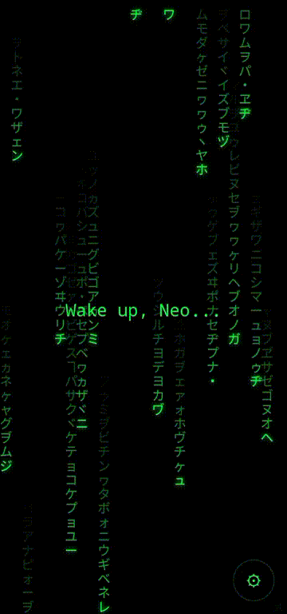
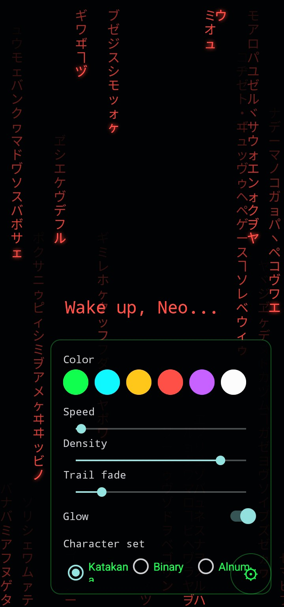
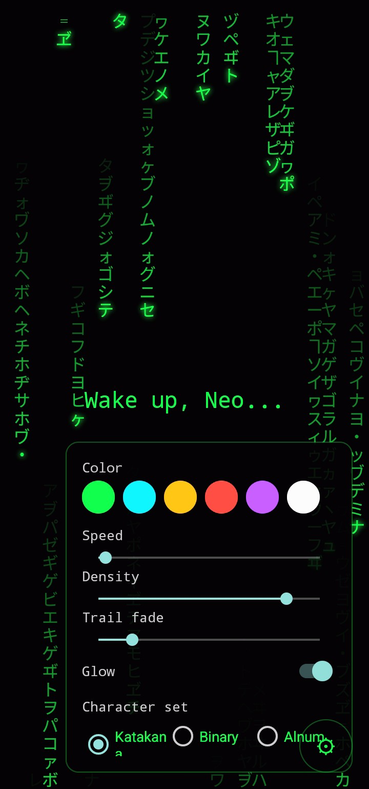
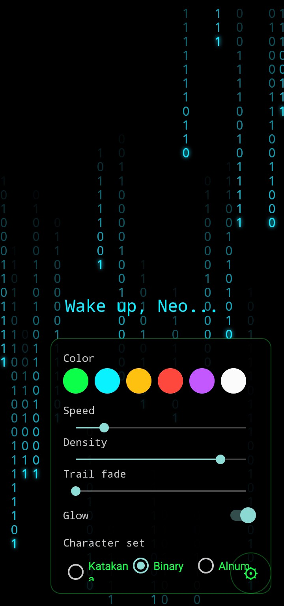

# matrix-rain-demo

[](https://github.com/boy-offi9-inc/matrix-rain-demo/actions/workflows/build-debug-apk.yml)

A tiny sample app showing [matrix-rain-view](https://github.com/boy-offi9-inc/matrix-rain-view)
in the "background effect" use case: a `MatrixRainView` running full-screen
*behind* real UI, rather than as a full-screen effect on its own. Includes a
live settings panel demonstrating every runtime-configurable property the
library exposes.

## Screenshots



<p float="left">
  
  
  
</p>

[Screen recording (mp4)](assets/video.mp4) — GitHub doesn't play local repo
videos inline, so this is a direct download link rather than an embedded
player.

## What it shows

`activity_main.xml` wraps a `FrameLayout` around two children:

1. `MatrixRainView`, bottom-most, filling the screen
2. A centered `LinearLayout` with real content on top

That ordering matters — `LinearLayout` arranges children edge-to-edge and
can't stack them, so the rain view has to be a `FrameLayout` (or
`ConstraintLayout`) child, not a `LinearLayout` sibling. This app is a
working, running proof of that pattern instead of just a doc claim.

A terminal-style console sheet at the bottom of the screen wires every
runtime-configurable property on `MatrixRainView` to a live control, split
into three tabs. The rain stays visible above it, and tapping the
`matrix@rain:~$ config` header collapses the sheet. Picking a rain color
re-tints the whole console to match.

| Tab | Controls |
| --- | --- |
| LOOK | Color (6 swatches), glyphs (Katakana / Binary / Alnum), speed 0.1x to 3.0x, density 0.1x to 2.0x, trail fade, glow |
| TOUCH | Flow around finger, flicker, shockwave on tap, glitch while held, touch radius 40dp to 200dp |
| FX | Glitch intensity 0 to 1, transparent background over a gradient |

Everything updates the running animation immediately — no restart needed —
since it's the same public properties any consuming app would use.

### Try the touch effects

Touch the rain above the console. Streams part around your
finger and close up behind it, glyphs under it flicker, and a quick tap sends
out a shockwave. Use two or more fingers to part the rain in several places
at once.

### Compose demo

The top-right `[ COMPOSE ]` button opens `ComposeDemoActivity`, a second
screen with the same console, tabs and controls, built with Jetpack Compose
and driving the library's `MatrixRain()` composable instead of the XML
`MatrixRainView` directly. It's proof the Compose wrapper is a drop-in
equivalent, not just a doc claim.

## Running it

Open in Android Studio and run the `app` module. A prebuilt debug APK is
available from the Actions tab (CI builds run on pushes to the `main`
branch).

The library itself is pulled from JitPack (latest release):

```kotlin
implementation("com.github.boy-offi9-inc:matrix-rain-view:1.2.0")
```
